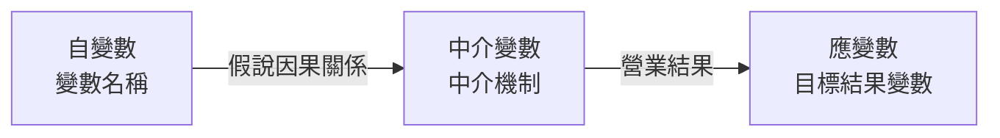
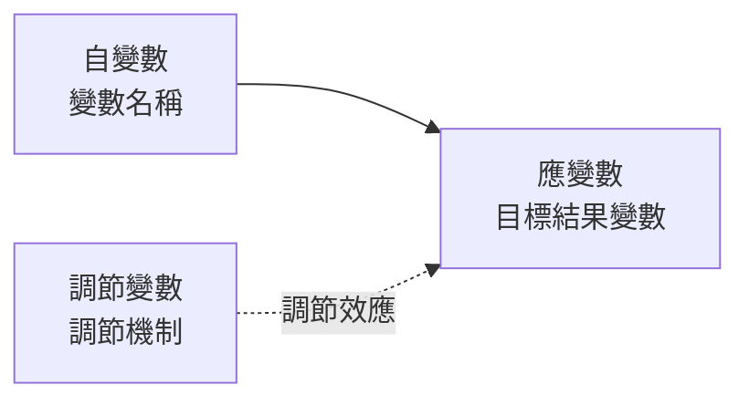

# AGENTS.md - 學術文獻摘要卡個人筆記網站 指南

本文件是此專案中 AI Agent 與開發者的最高協作規範。所有後續的架構建立、程式編寫、檔案維護與筆記生成，皆必須嚴格遵守本文件所載之原則與規範。

---

## 1. 專案目的 (Project Purpose)
* **核心理念**：「一篇文章 / 一個主題 = 一張結構化摘要卡」。
* **核心標語 (Slogan)**：「一卡提煉核心脈絡 · 快速掌握學術研究精髓」。
* **領域定位**：專門為**學術論文（涵蓋會計、財務、管理及各類商管實證研究，但不限於會計領域）**所設計之摘要卡庫。
* **主要目的**：以結構化因果關係圖與假說卡片，讓使用者在極短時間內**快速掌握論文核心重點與實證結論**。

---

## 2. 運作方式 (Architecture & Mechanism)
* **靜態資料驅動**：所有文獻筆記均以純 Markdown（`.md`）檔案存放在 `notes/` 目錄。
* **首頁動態整合**：最外層的 `index.html` 透過輕量 JavaScript（載入 `marked.js` 與 `mermaid.js`）讀取筆記目錄或清單索引，動態生成文獻卡片網格。
* **互動體驗**：
  * **卡片網格**：首頁提供搜尋列、年份/期刊/標籤篩選器，並以卡片呈現每篇文獻的頂部抬頭與一句話總結。
  * **展開檢視**：點擊卡片後於頁面原處展開或以 Modal 彈跳視窗展示完整的「單頁簡報式摘要卡」。
  * **圖表即時繪製**：載入筆記內容時，自動將 Mermaid 代碼區塊即時繪製為清晰的變數架構圖。

---

## 3. 技術限制 (Technical Constraints)
* **零複雜框架**：嚴禁使用 React、Vue、Angular、Vite、Webpack、Next.js 或 Node.js 建置流程。
* **純前端靜態相容**：僅使用標準的 HTML5、CSS3、Vanilla JavaScript（原生 ES6+）。
* **GitHub Pages 隨插即用**：專案 push 至 GitHub Pages 根目錄後必須可直接執行，不需任何 CI/CD Build step。
* **第三方相容庫（採 CDN 引入）**：
  * `marked.js`（用於解析 Markdown）
  * `mermaid.js`（用於渲染研究變數因果圖）
  * 不得依賴需付費授權或需 API Token 的外部服務。

---

## 4. 檔案結構與命名規範 (File Structure & Naming)
專案整體檔案結構如下：

```text
academic-notes/
├── AGENTS.md                  # 本協作規範檔案
├── index.html                 # 最外層入口頁面（含卡片牆與閱讀器）
├── css/
│   └── style.css              # Notion 風格樣式表
├── js/
│   ├── app.js                 # 核心邏輯（載入清單、搜尋、篩選、渲染）
│   └── manifest.js (或 notes.json) # 筆記清單索引（紀錄現有筆記檔名與關鍵欄位）
└── notes/                     # 文獻筆記存放目錄
    ├── 2024-author-topic.md
    └── 2023-smith-csr-performance.md
```

### 檔案命名規範
1. 筆記檔名必須採小寫烤肉串命名法（kebab-case）：
   `{西元年份}-{第一作者姓氏}-{主題關鍵字}.md`
   * 範例：`2024-tang-ceo-narcissism.md`、`2023-smith-esg-firm-value.md`
2. 不得包含空格、中文或特殊符號。

---

## 5. 新增筆記的固定格式（嚴格簡報單頁規範）

每篇存於 `notes/` 中的 Markdown 筆記，必須採用以下統一格式範本，不可省略任何段落：

```markdown
---
id: "2024-author-topic"
title: "論文完整英文或中文標題"
authors: "第一作者, 第二作者, 通訊作者"
year: 2024
journal: "Journal Name (如: Strategic Management Journal, AMJ)"
tags: ["關鍵字1", "關鍵字2", "研究主題"]
---

# 論文標題

> **一句話總結 (Key Takeaway)**:
> 用簡潔 1-2 句話精確說明本研究最重要的核心發現或理論貢獻。

---

## 變數關係圖

> 規範：必須區分不同假說「分別繪製變數關係圖」，各假說有其專屬的簡潔 Mermaid 圖表。變數名稱後**不加括號英文簡寫**（如不需要標註 (IV), (DV)），一律採用標準中文學術稱謂（自變數、中介變數、調節變數、應變數）。

### H1 變數關係圖


### H2 變數關係圖


---

## 樣本與研究方法

| 項目 | 說明 |
| :--- | :--- |
| **樣本國別 / 市場** | 例如：美國 S&P 500、台灣上市櫃公司 |
| **研究期間** | 例如：2010 年 - 2022 年（共 13 年） |
| **樣本數量 / 觀測值** | 例如：1,250 家企業，共 8,400 筆公司-年度觀測值 (Firm-Year Obs) |
| **主要計量實證模型** | 例如：雙向固定效應模型 (Two-way Fixed Effects), 2SLS 工具變數法, DID |

---

## 研究假說與驗證結果

* **H1 (假說名稱)**: 自變數對中介變數具有顯著正向影響 [顯著正相關***]
* **H2 (假說名稱)**: 中介變數對應變數具有顯著負向影響 [顯著負相關**]
* **H3 (假說名稱)**: 自變數對應變數具有直接正向影響 [不顯著]
* **H4 (假說名稱)**: 調節變數正向強化自變數與中介變數之關係 [顯著正相關*]
```

---

## 6. 只整理使用者給予的資料（嚴格邊界規則）
AI Agent 在協助整理論文並撰寫筆記時，**必須恪守以下數據邊界**：
1. **嚴禁臆測與虛構**：僅能依據使用者提供的文獻摘要、全文或截圖整理。嚴禁利用預訓練模型自行想像樣本數、p-value、期刊名稱或未提及的統計數據。
2. **缺漏標註**：若使用者提供的文獻資訊中未提及特定項目（例如「未提及具體樣本數」或「未列出調節假說」），請直接填寫 `未揭露`、`文中未提及` 或 `N/A`，絕不可自行腦補。
3. **保持客觀中立**：忠實呈現論文原作者的假設與檢定結果，不隨意加油添醋。

---

## 7. 視覺風格 (Visual Style)
* **整體定位**：**溫暖雅緻的 Notion 知識庫 / Editorial 學術風格**。
* **色調規劃**：
  * 背景：溫暖米白／宣紙色背景（`#FAF8F5`、`#F4EFEB`），卡片本體為純白（`#FFFFFF`）搭配溫暖柔和邊框（`#E8E2D8`）。
  * 文字：暖調深炭褐／深濃縮咖啡色主文字（`#2D2823`），說明使用溫暖灰褐（`#6E665E`）。
  * 強調色：暖焦糖／琥珀色（`#B85D19`），營造沉穩、高質感的紙本書報閱讀體驗。
  * 標籤徽章 (Badges)：採用溫暖低飽和配色：
    * `[顯著正相關]`：溫和鼠尾草綠（`#EAF3EA`，文字 `#245C29`），搭配星星符號（`*`、`**`、`***`）。
    * `[顯著負相關]`：溫和陶土橘紅（`#FDF1E7`，文字 `#964218`），搭配星星符號。
    * `[不顯著]`：溫潤暖石灰（`#EFECE6`，文字 `#696259`，直接標示不顯著）。
* **排版規範**：
  * 卡片圓角：`border-radius: 8px` 至 `12px`，搭配極細微暖調陰影（`box-shadow: 0 4px 16px rgba(70, 50, 30, 0.07)`）。
  * 假說清單排版：嚴禁出現勾選方框，採整齊三欄卡片行（假說代號欄、說明欄、實證標籤欄），兩端對齊無懸掛符號。

---

## 8. 修改規則與完成檢查清單 (Checklist & Modification Rules)

### 修改原則
* 遵循「最小更動原則」，修改程式碼時切勿破壞現有已正常運作的 Markdown 解析與 Mermaid 渲染邏輯。
* 維護 `notes/` 與 `manifest` 同步更新：每當新增筆記檔案時，務必確保索引檔（`manifest`）包含該筆記基本 metadata，以供首頁卡片網格立即索引。

### 完成檢查清單 (Pre-flight Checklist)
每次新增文獻或更新程式時，必須逐項核對以下檢查項目：
- [ ] 1. **檔案命名**：是否符合 `{YYYY}-{author}-{topic}.md` 規範且全小寫。
- [ ] 2. **單頁規格嚴格落實**：
  - [ ] 頂部抬頭（標題、作者、年份、期刊）皆齊全。
  - [ ] 一句話總結（Key Takeaway）精確且在 1-2 句內。
  - [ ] 標題為「變數關係圖」，並區分不同假說分別繪製專屬 Mermaid 圖表。
  - [ ] 樣本與研究方法表格完整（國別、期間、樣本數、計量模型）。
  - [ ] 假說檢定皆依標準標示 `[顯著正相關***]`、`[顯著負相關**]`（`* p < 0.1`、`** p < 0.05`、`*** p < 0.01`）或 `[不顯著]`，且排版整齊對齊、無勾選框。
- [ ] 3. **無臆測內容**：所有數值與結論皆來自使用者給定的原始材料。
- [ ] 4. **GitHub Pages 相容性**：靜態路徑均為相對路徑，本地直接雙擊或啟動簡易 HTTP 伺服器均能正確顯示。
