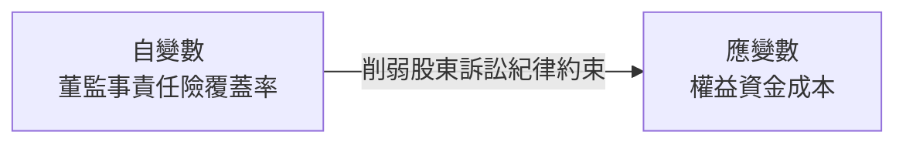
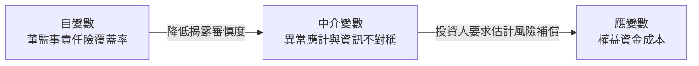
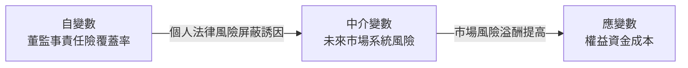
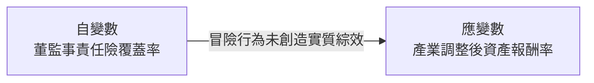

# Directors' and officers' liability insurance and the cost of equity

> **一句話總結 (Key Takeaway)**:
> 董監事責任保險的覆蓋比率愈高，企業之權益資金成本愈高；主因在於責任險弱化了私人股東訴訟的法規紀律約束力，導致財務報告品質下降、資訊不對稱加劇，並誘發經理人過度追求風險。

---

## 變數關係圖

### H1 變數關係圖 (權益資金成本推升檢定)

### H2 變數關係圖 (財報資訊品質中介機制)

### H3 變數關係圖 (經理人風險承擔推升機制)

### H4 變數關係圖 (實質營運現金流檢定)

---

## 樣本與研究方法

| 項目 | 說明 |
| :--- | :--- |
| **樣本國別 / 市場** | 加拿大多倫多證券交易所 (TSE 300) 指數涵蓋之大型上市企業（排除金融業，自 SEDAR 代理委託書逐筆人工蒐集保險限額） |
| **研究期間** | 1996 年 - 2008 年（共 13 年） |
| **樣本數量 / 觀測值** | 主模型迴歸樣本約 2,025 筆公司-年度觀測值 (Firm-Year Observations) |
| **主要計量實證模型** | 多變量 OLS 與 Fama-MacBeth 迴歸模型，估計事前權益資金成本，並利用 2001 年美國內華達州降低經理人忠實與注意義務法律之修訂進行雙重差分法外生衝擊檢驗。 |

---

## 研究假說與驗證結果

* **H1 (資金成本推升檢定)**: 責任保險削弱股東訴訟之威嚇約束效果，導致股票投資人要求更高之權益資金成本風險溢酬 [顯著正相關***]
* **H2 (資訊透明度下降機制)**: 責任險覆蓋率較高之企業，其異常應計項目絕對值顯著偏高且股票流動性顯著惡化 [顯著正相關***]
* **H3 (經理人過度冒險機制)**: 責任保險免除董監事個人賠償責任，促使經理人更傾向承擔過度風險並推升未來貝他值 [顯著正相關*]
* **H4 (實質營運改善檢定)**: 責任保險所激勵之風險承擔行為，並未對企業未來長遠之營業現金流量與資產報酬率帶來顯著改善 [不顯著]
