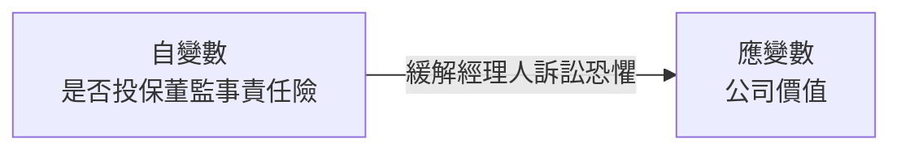
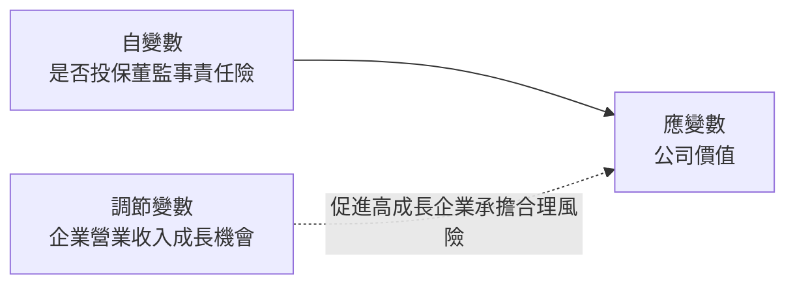
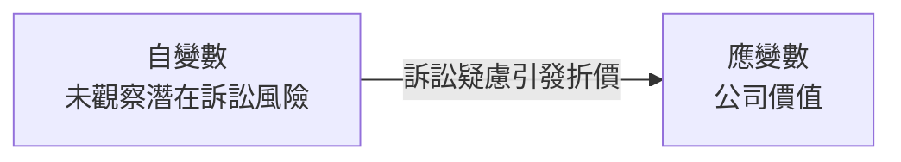

# Directors' and Officers' Liability Insurance and Firm Value

> **一句話總結 (Key Takeaway)**:
> 韓國上市公司投保董監事責任險能顯著提升公司價值；此正面效應在具備「高成長機會」之企業中尤為突出，證實責任險能緩解經理人因恐懼訴訟而過度規避風險所引發的投資不足問題。

---

## 變數關係圖

### H1 變數關係圖 (責任保險對公司價值檢定)

### H2 變數關係圖 (成長機會之調節激勵效應)

### H3 變數關係圖 (潛在訴訟風險自選擇檢驗)

---

## 樣本與研究方法

| 項目 | 說明 |
| :--- | :--- |
| **樣本國別 / 市場** | 韓國證券交易所 (KRX) 上市企業（排除金融業，選取法令強制揭露責任保險明細之代表性時期） |
| **研究期間** | 2002 年 - 2008 年（共 7 年） |
| **樣本數量 / 觀測值** | 涵蓋 512 家上市企業，共 2,571 筆公司-年度觀測值（其中投保樣本 814 筆，未投保樣本 1,757 筆） |
| **主要計量實證模型** | 內生性處理效果模型（採 Heckman 兩步驟估計法），並採用 Blundell & Bond 系統廣義矩估計法 (System GMM) 估計動態面板資料模型，嚴密控制時間序列相依性與內生性偏誤。 |

---

## 研究假說與驗證結果

* **H1 (公司價值提升檢定)**: 企業投保董監事責任保險能有效降低管理層訴訟顧慮，帶動未來公司市場價值顯著上升 [顯著正相關***]
* **H2 (成長機會調節檢定)**: 針對具備高營收成長機會之企業，責任保險促進良性冒險與避免投資不足之效果更為顯著 [顯著正相關**]
* **H3 (未觀察訴訟風險檢驗)**: 促使企業自願購買責任保險之潛在未觀察訴訟風險因素，對企業未來公司價值呈現折價影響 [顯著負相關***]
