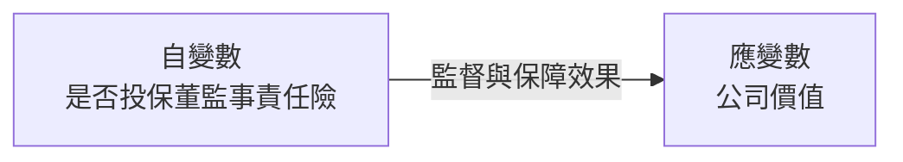
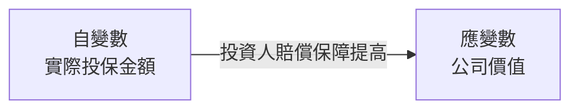
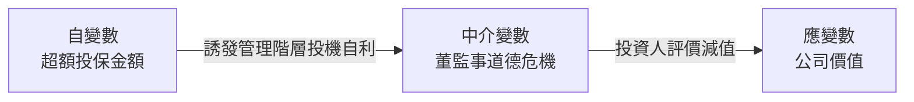

# 董監事責任保險與公司價值之關聯性：從股票投資者角度探討

> **一句話總結 (Key Takeaway)**:
> 臺灣上市櫃公司投保董監事責任保險且實際投保金額愈高時，股票投資人給予較高之公司價值評價；但若出現超出正常風險所需之超額投保，則會因引發管理層道德危機疑慮而導致公司價值顯著減損。

---

## 變數關係圖

### H1 變數關係圖 (是否投保對公司價值檢定)

### H2a 變數關係圖 (實際投保金額之保障效果)

### H2b 變數關係圖 (超額投保誘發道德危機檢定)

---

## 樣本與研究方法

| 項目 | 說明 |
| :--- | :--- |
| **樣本國別 / 市場** | 臺灣上市與上櫃公司（排除金融保險業、證券業與全額交割管理股票） |
| **研究期間** | 2008 年 - 2015 年（共 8 年） |
| **樣本數量 / 觀測值** | 最終有效研究樣本共 10,355 筆觀察值（其中投保責任保險觀察值為 6,030 筆，佔比 58.23%） |
| **主要計量實證模型** | 內生性二元處理模型，分離公司自願投保之自我選擇效果，並輔以傾向分數配對法與二階段工具變數法檢驗穩健性。 |

---

## 研究假說與驗證結果

* **H1 (有無投保關聯檢定)**: 企業購買董監事責任保險能強化外部監督並吸引經營人才，對公司價值產生正面評價 [顯著正相關***]
* **H2a (實際投保金額檢定)**: 在有投保之公司中，實際投保金額愈高提供投資人更充裕之賠償保障，公司價值顯著較高 [顯著正相關***]
* **H2b (超額投保金額檢定)**: 超過正常風險水準之超額投保金額愈高，誘發董監事道德危機與投機行為，公司價值顯著偏低 [顯著負相關***]
