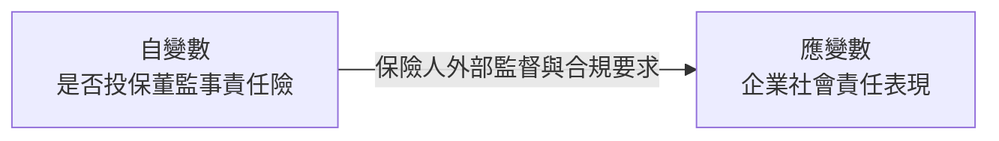
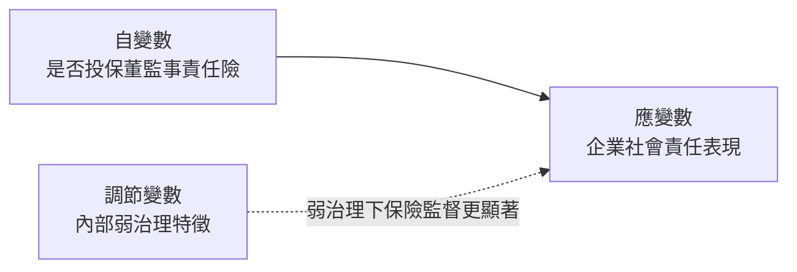
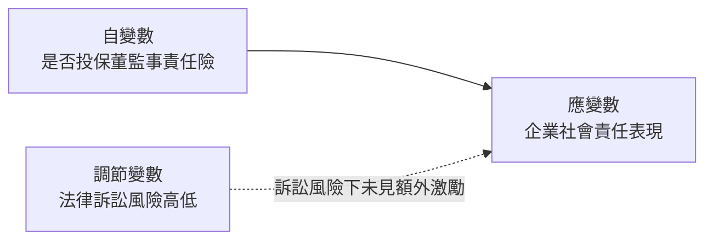
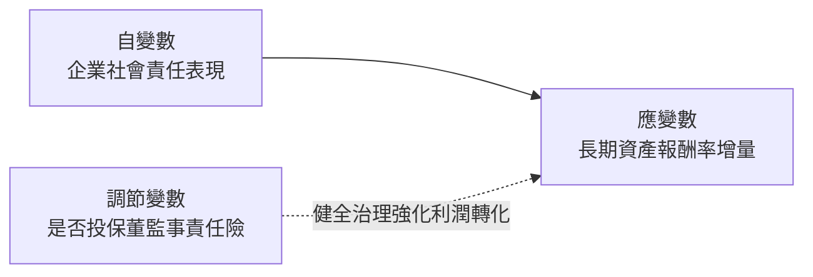

# The effect of directors' and officers' liabilities insurance on corporate social responsibility evidence from China

> **一句話總結 (Key Takeaway)**:
> 中國上市公司購買董監事責任保險能顯著提升企業社會責任表現；此治理效益在內部治理較弱與在地保險業發展成熟之企業尤為顯著，且責任保險有助於深化社會責任對長期營運績效之實質貢獻。

---

## 變數關係圖

### H1a 變數關係圖 (責任保險治理效應檢定)

### H2a 變數關係圖 (弱治理環境之調節強化)

### H3a 變數關係圖 (風險承擔假說檢驗)

### H4 變數關係圖 (對長期經營績效之調節效果)

---

## 樣本與研究方法

| 項目 | 說明 |
| :--- | :--- |
| **樣本國別 / 市場** | 中國 A 股上市公司 (資料取自 CSMAR、CNRDS 與潤靈環球 RKS 評級，排除金融與 ST 企業) |
| **研究期間** | 2008 年 - 2018 年（共 11 年） |
| **樣本數量 / 觀測值** | 主模型迴歸樣本共 6,104 筆公司-年度觀測值 (Firm-Year Observations) |
| **主要計量實證模型** | 多變量 OLS 迴歸模型（控制年度、產業與省份固定效應），並採用傾向分數配對法、Heckman 兩階段選擇模型及二階段工具變數法控制內生性。 |

---

## 研究假說與驗證結果

* **H1a (治理監督效應檢定)**: 企業投保董監事責任保險能促使保險機構介入監督與合規要求，顯著提升社會責任評分 [顯著正相關**]
* **H2a (弱治理下強化效果)**: 在董事長兼總經理或獨董比例偏低之弱治理公司中，責任保險所發揮之外部治理成效更為顯著 [顯著正相關***]
* **H3a (風險鼓勵假說檢定)**: 面臨法律訴訟風險較高之企業，責任保險並未因提供財務盾牌而更積極促使經理人從事高風險社會責任 [不顯著]
* **H4 (長期績效調節效應)**: 責任保險能有效正向調節社會責任對企業長遠營運績效之傳導機制，顯著提升資產報酬率增量 [顯著正相關***]
