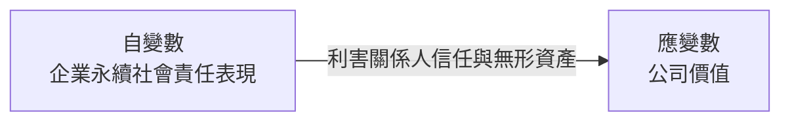
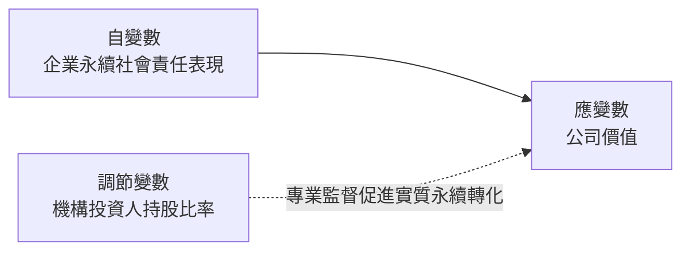
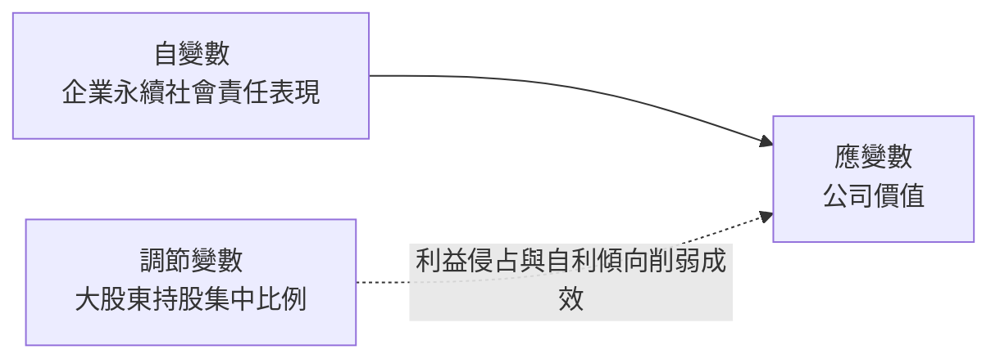
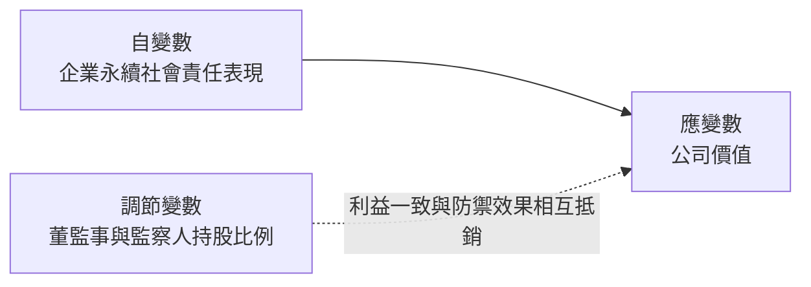

# Does Ownership Structure Matter? The Moderating Role of Ownership Structure in the ESG–Firm Value Relationship: Evidence from Taiwanese Financial Holding Companies

> **一句話總結 (Key Takeaway)**:
> 以臺灣上市金融控股公司為對象，證實企業永續 ESG 表現能顯著創造公司價值；且機構投資人持股具有顯著正向強化之治理效應，大股東持股則產生負向削弱效果，董監持股之調節效果則未達統計顯著。

---

## 變數關係圖

### H1 變數關係圖 (永續表現對公司價值直接效應)

### H2 變數關係圖 (機構投資人持股之正向調節)

### H3 變數關係圖 (大股東股權集中之負向調節)

### H4 變數關係圖 (董監事持股比率之調節檢驗)

---

## 樣本與研究方法

| 項目 | 說明 |
| :--- | :--- |
| **樣本國別 / 市場** | 臺灣證券交易所 (TWSE) 上市之全體 13 家金融控股公司 |
| **研究期間** | 2016 年第一季 - 2025 年第四季（共 10 年，季度時間序列） |
| **樣本數量 / 觀測值** | 總計 520 筆公司-季度觀測值 (Firm-Quarter Observations) |
| **主要計量實證模型** | 階層迴歸分析模型 (Hierarchical Regression Analysis)，循序檢定控制變數基準模型、ESG 直接效果模型、股權結構直接模型及交乘項調節模型，並經平均數中心化處理與變異數膨脹因子 (VIF) 檢定排除共線性。 |

---

## 研究假說與驗證結果

* **H1 (永續價值創造檢定)**: 金融控股公司之企業社會責任永續表現愈優異，市場投資人賦予之公司價值評估顯著較高 [顯著正相關***]
* **H2 (機構持股調節檢定)**: 機構投資人具備專業監督動能，顯著正向強化社會責任表現轉化為公司市場價值之成效 [顯著正相關***]
* **H3 (大股東持股調節檢定)**: 大股東股權集中度過高易誘發控制權私人利益追求，顯著削弱社會責任對公司價值之貢獻 [顯著負相關***]
* **H4 (董監持股調節檢定)**: 董監事持股比率因利益收斂效果與管理防禦效應相互抗衡，對社會責任價值之調節未展現顯著影響 [不顯著]
